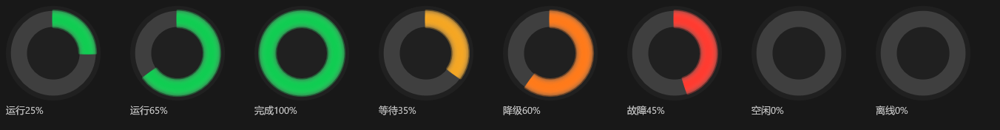
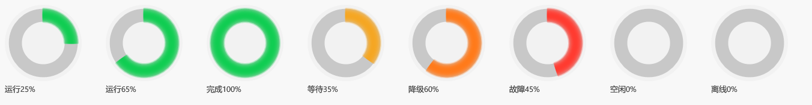

# DSH HaloRing

为 DeepSeek Harness（DSH）打造的 **Windows 11 系统托盘环形状态指示灯**。

环的颜色代表 DSH 当前状态，环的弧长代表任务进度，一眼就能知道 Agent 在做什么。

- **纯本地**：不联网，只读本地状态文件
- **可自定义**：颜色、粗细、主题、动画全部可调
---

## 预览

### 夜间主题（底板 `#202020`）

八个状态横向排列，每个图标都是完整渲染结果：



### 日间主题（底板 `#F2F2F2`）

切换主题只改变底板色与轨道色，其余参数不变：




## 特性

### 七种状态，一眼可辨

| 状态 | 颜色 | 表现 |
|---|---|---|
| 运行中 | 绿色 `#10CD52` | 常亮 |
| 等待输入/授权 | 琥珀 `#F5A623` | 慢闪（1.6s） |
| 降级运行 | 橙色 `#FF7A1A` | 快闪（0.42s） |
| 故障/阻塞 | 红色 `#FF3B30` | 常亮 + 周期性双闪 |
| 完成/回合结束 | 绿色 `#10CD52` | 满环 + 慢闪，直到下一状态 |
| 空闲/待机 | 暗绿 `#2F6B45` | 常亮 |
| 离线/失联 | 暗灰 `#5A5A5A` | 常亮 |

多个状态同时成立时按**固定优先级**取一个

```
故障 > 降级 > 等待输入/授权 > 运行中 > 完成 > 空闲 > 离线
```

### 进度提示

环的弧长是**非精确提示**，不承诺准确百分比。进度来自 DSH 的 `step` 事件
（一次 `step` = 一次「模型推理 → 工具调用 → 工具执行完毕」循环）：

```
progress = 25 + 70 × (1 - e^(-已完成step数 / 3.2))  [+8 若正在执行工具]
```

因为**总步数未知**，刻意用渐近曲线而非线性分母，避免长任务卡在某个数字不动的观感。
上限 95，只有回合结束才到 100。进度变化时环弧长**线性平滑增长**，不跳变。


## 快速开始

## 安装方式

**方式一：安装包（推荐）**
下载 `DshHaloRing-Setup-1.0.0.exe`，双击安装。
自带 .NET 运行时，无需管理员权限。

**方式二：便携版**
下载 `DshHaloRing-1.0.0-portable.zip`，解压到任意目录，
双击 `DshHaloRing.exe` 即可运行。

## 首次运行提示

本版本未做代码签名，Windows 可能提示「已保护你的电脑」，
点「更多信息」→「仍要运行」即可。

## 1. 安装 DSH 状态桥插件

托盘程序靠一个 DSH 宿主插件获取状态。在 DSH 所在终端执行：

```powershell
dsh plugin --profile desktop add "https://github.com/DeeepMind/dsh-haloring-status.git"
```

安装后**重启 DSH 一次**加载插件。验证：`%USERPROFILE%\.dsh\dsh-status.txt`
应出现且每秒更新。

### 2. 配置数据源（默认即可）

首次运行默认用演示驱动。右键托盘图标 →「外观设置」→「状态源」→
选 **DSH 状态桥（推荐）**，路径留空即自动指向 `%USERPROFILE%\.dsh\dsh-status.txt`。

托盘交互：

- **左键单击** → 打开外观设置
- **右键** → 菜单（进度显示 / 外观设置 / 恢复默认外观 / 开机自启动 / 退出）

---
## 许可证

[GPL-3.0](LICENSE)

你可以自由使用、修改和分发，但衍生作品必须以相同许可证开源。
